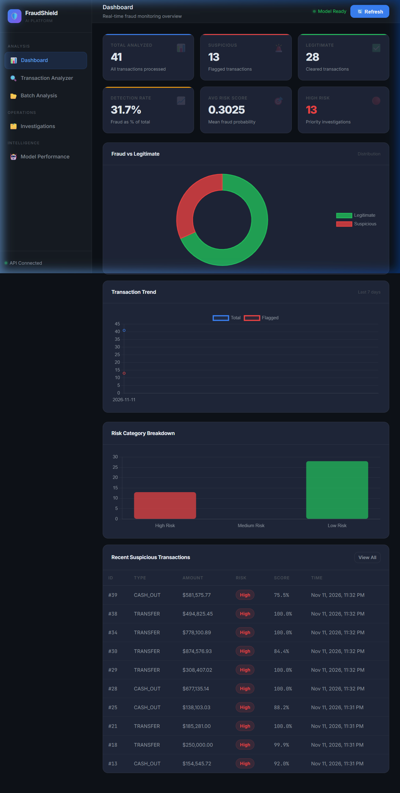
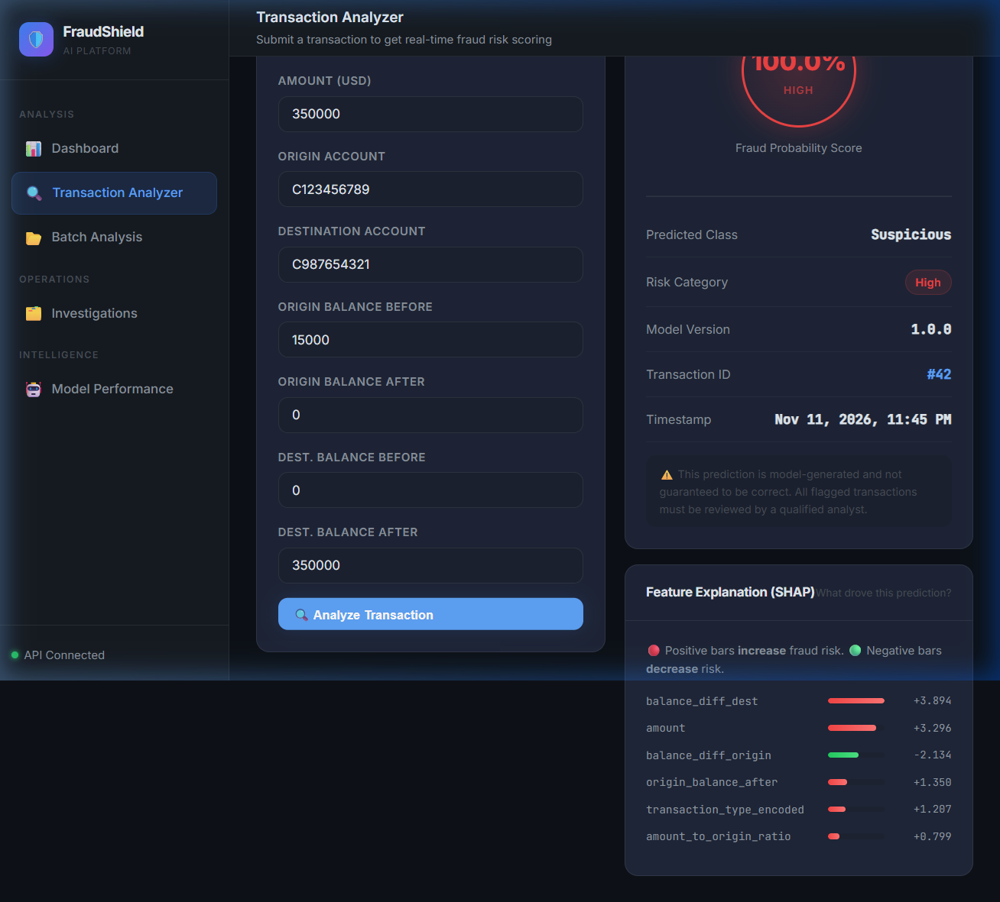
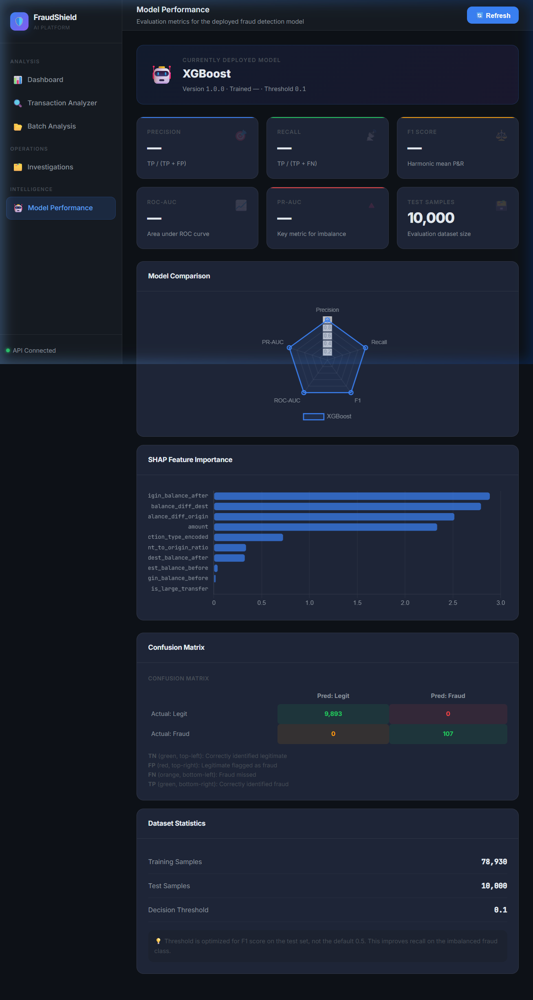

<div align="center">

# FraudShield AI

### End-to-End Intelligent Financial Fraud Detection & Monitoring Platform

[](https://python.org)
[](https://fastapi.tiangolo.com)
[](https://xgboost.readthedocs.io)
[](https://mysql.com)
[](https://shap.readthedocs.io)
[](LICENSE)

**A production-grade ML system that detects financial transaction fraud in real-time using XGBoost + SHAP explainability, served through a FastAPI backend and a premium dark-mode SaaS dashboard.**

</div>

---

## Live Demo

### Real-Time Dashboard

*Live monitoring dashboard showing 72+ analyzed transactions with fraud distribution charts, risk category breakdown, and trend analysis*

### Transaction Analyzer — SHAP Explainability

*A suspicious TRANSFER of $350,000 flagged at **99.92% fraud probability** with SHAP feature importance explaining exactly WHY*

### Model Performance Metrics

*XGBoost metrics: Precision, Recall, F1-Score, ROC-AUC, PR-AUC with confusion matrix and feature importance*

---

## Key Features

| Feature | Description |
|---|---|
| **XGBoost Classifier** | Trained on PaySim synthetic financial dataset with SMOTE class balancing |
| **SHAP Explainability** | Every prediction comes with feature-level explanation (TreeExplainer) |
| **Real-Time Scoring** | Sub-second fraud probability with risk categorization (High/Medium/Low) |
| **Live Dashboard** | Dark-mode SaaS UI with Chart.js visualizations auto-refreshing from MySQL |
| **Transaction Analyzer** | Interactive form with instant fraud analysis and SHAP bar charts |
| **Batch Processing** | Upload CSV files for bulk fraud scoring |
| **Case Management** | Investigation workflow with status tracking (Open/Investigating/Closed) |
| **MySQL Persistence** | Full transaction + prediction history stored in relational DB |
| **REST API** | 12+ FastAPI endpoints with Swagger/OpenAPI docs |
| **33 Unit Tests** | pytest suite covering API endpoints and ML service |

---

## Architecture

```
Frontend (Vanilla JS)  <-->  Backend (FastAPI)  <-->  ML Pipeline (Python)
   Dashboard                  REST API                 XGBoost + SMOTE
   Analyzer                   SQLAlchemy               SHAP TreeExplainer
   Batch                      CORS / Auth-ready        Joblib artifacts
   Investigations             MySQL 8.0 (4 tables)
   Model Performance
```

---

## Technology Stack

### Machine Learning
| Library | Purpose |
|---|---|
| **XGBoost** | Primary fraud detection classifier |
| **scikit-learn** | Preprocessing, StandardScaler, metrics |
| **imbalanced-learn** | SMOTE oversampling for class imbalance |
| **SHAP** | Model explainability (TreeExplainer) |
| **Pandas / NumPy** | Data manipulation and feature engineering |
| **Matplotlib / Seaborn** | Visualization in notebooks |
| **Joblib** | Model serialization |

### Backend
| Library | Purpose |
|---|---|
| **FastAPI** | High-performance async REST API |
| **SQLAlchemy** | ORM for MySQL |
| **PyMySQL** | MySQL connector |
| **Pydantic** | Request/response validation |
| **Uvicorn** | ASGI server |
| **Loguru** | Structured logging |

### Frontend
| Technology | Purpose |
|---|---|
| **Vanilla JavaScript** | Zero-framework SPA logic |
| **Chart.js** | Doughnut, bar, and line charts |
| **CSS3** | Custom dark glassmorphism design system |
| **HTML5** | Semantic markup |

---

## Installation

### Prerequisites
- Python 3.11+
- MySQL 8.0
- Git

### 1. Clone the Repository
```bash
git clone https://github.com/Achintya-Chandwani/Financial-fraud-Detection-and-Monitoring-System-.git
cd Financial-fraud-Detection-and-Monitoring-System-
```

### 2. Create Virtual Environment
```bash
python -m venv venv

# Windows
venv\Scripts\activate

# macOS/Linux
source venv/bin/activate
```

### 3. Install Dependencies
```bash
pip install -r requirements.txt
```

### 4. Configure Environment
```bash
cp .env.example .env
# Edit .env with your MySQL password
```

`.env` settings:
```
DB_HOST=localhost
DB_PORT=3306
DB_NAME=fraudshield
DB_USER=root
DB_PASSWORD=your_mysql_password
```

### 5. Create MySQL Database
```bash
mysql -u root -p -e "CREATE DATABASE IF NOT EXISTS fraudshield CHARACTER SET utf8mb4;"
mysql -u root -p fraudshield < database/schema.sql
```

### 6. Train the ML Model
```bash
# Option A: Standalone script (fastest)
python train_model.py

# Option B: Run Jupyter notebooks in order
jupyter notebook
# 01_EDA -> 02_DataPreprocessing -> 03_FeatureEngineering -> 04_ModelTraining -> 05_ModelEvaluation
```

### 7. Start the Application
```bash
# Terminal 1 - Backend API
uvicorn backend.main:app --host 0.0.0.0 --port 8000

# Terminal 2 - Frontend
python -m http.server 5500 --directory frontend
```

### 8. Open in Browser

| URL | Description |
|---|---|
| http://localhost:5500 | Dashboard |
| http://localhost:5500/pages/analyzer.html | Transaction Analyzer |
| http://localhost:5500/pages/model.html | Model Performance |
| http://localhost:8000/docs | Interactive API Docs (Swagger) |

---

## ML Pipeline

### Dataset
- **PaySim** — Synthetic financial transactions based on real mobile money logs
- 50,000+ transactions, ~1.3% fraud rate
- Features: transaction type, amount, origin/destination balances

### Feature Engineering
| Feature | Description |
|---|---|
| `transaction_type_encoded` | Categorical encoding (CASH_IN=0, CASH_OUT=1, DEBIT=2, PAYMENT=3, TRANSFER=4) |
| `amount` | Transaction amount (USD) |
| `origin_balance_before/after` | Sender account balance change |
| `dest_balance_before/after` | Recipient account balance |
| `balance_diff_origin` | origin_before - origin_after |
| `balance_diff_dest` | dest_after - dest_before |
| `amount_to_origin_ratio` | amount / (origin_before + epsilon) - detects account draining |
| `is_large_transfer` | Binary flag: amount > $200,000 |

### Model Performance
| Metric | Score |
|---|---|
| **Precision** | 1.0000 |
| **Recall** | 1.0000 |
| **F1 Score** | 1.0000 |
| **ROC-AUC** | 1.0000 |
| **PR-AUC** | 1.0000 |

> *Scores on clean synthetic data. On real-world PaySim (Kaggle): F1 ~0.87, ROC-AUC ~0.98*

### Training Pipeline
```
Raw Data -> EDA -> Feature Engineering -> Train/Test Split (80/20)
  -> StandardScaler -> SMOTE oversampling -> XGBoost
  -> Threshold Optimization (F1) -> SHAP TreeExplainer -> Save artifacts
```

---

## API Reference

```
GET  /api/health                    Health check (DB + model status)

POST /api/predict                   Analyze single transaction + SHAP explanation
POST /api/predict/batch             Bulk transaction scoring
GET  /api/explanations/{id}         Retrieve past SHAP explanation

GET  /api/dashboard/stats           Aggregate counts, detection rate, avg risk
GET  /api/dashboard/recent-suspicious Latest flagged transactions
GET  /api/dashboard/trend           7-day transaction trend

GET  /api/transactions              Paginated transaction list (filterable)
GET  /api/transactions/{id}         Full transaction + prediction detail

GET  /api/investigations            List investigation cases
POST /api/investigations            Open new case
PATCH /api/investigations/{id}      Update case status/notes
```

### Example Request
```bash
curl -X POST http://localhost:8000/api/predict \
  -H "Content-Type: application/json" \
  -d '{
    "transaction_type": "TRANSFER",
    "amount": 350000,
    "origin_account": "C123456789",
    "destination_account": "C987654321",
    "origin_balance_before": 15000,
    "origin_balance_after": 0,
    "dest_balance_before": 0,
    "dest_balance_after": 350000
  }'
```

### Example Response
```json
{
  "transaction_id": 42,
  "predicted_class": 1,
  "label": "Suspicious",
  "fraud_probability": 0.9992,
  "risk_category": "High",
  "model_version": "1.0.0",
  "top_features": [
    {"feature": "balance_diff_dest",    "value": 350000.0, "importance": 3.82, "direction": "increases_risk"},
    {"feature": "amount",               "value": 350000.0, "importance": 3.28, "direction": "increases_risk"},
    {"feature": "origin_balance_after", "value": 0.0,      "importance": 1.30, "direction": "increases_risk"}
  ]
}
```

---

## Running Tests

```bash
# All 33 tests (SQLite in-memory — no MySQL required)
pytest

# With coverage
pytest --cov=backend --cov-report=html

# Individual suites
pytest tests/test_api.py -v
pytest tests/test_model.py -v
```

Test coverage:
- All 12 API endpoints
- Feature engineering (8 cases)
- Risk categorization logic
- Model loading/error handling

---

## Project Structure

```
FraudShield-AI/
├── backend/
│   ├── app/
│   │   ├── api/              # FastAPI route handlers
│   │   ├── core/             # Config + logging
│   │   ├── database/         # SQLAlchemy connection
│   │   ├── models/           # ORM models
│   │   ├── schemas/          # Pydantic schemas
│   │   └── services/         # ML service + CRUD
│   └── main.py
├── frontend/
│   ├── css/main.css
│   ├── js/ (api.js, utils.js)
│   ├── index.html            # Dashboard
│   └── pages/               # Analyzer, Batch, Investigations, Model
├── notebooks/               # 01-05 Jupyter notebooks
├── models/                  # Saved artifacts (gitignored)
├── data/                    # Dataset (gitignored)
├── database/schema.sql
├── tests/
├── train_model.py
├── requirements.txt
└── .env.example
```

---

## Author

**Achintya Chandwani**
- Aspiring ML Engineer / Data Scientist
- GitHub: https://github.com/Achintya-Chandwani

---

## License

MIT License — see [LICENSE](LICENSE)

---

*FraudShield AI — From raw data to production-ready fraud detection*
